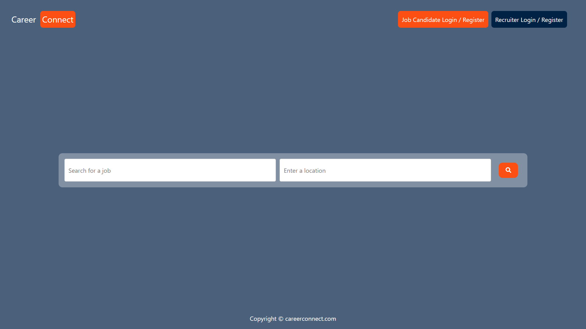
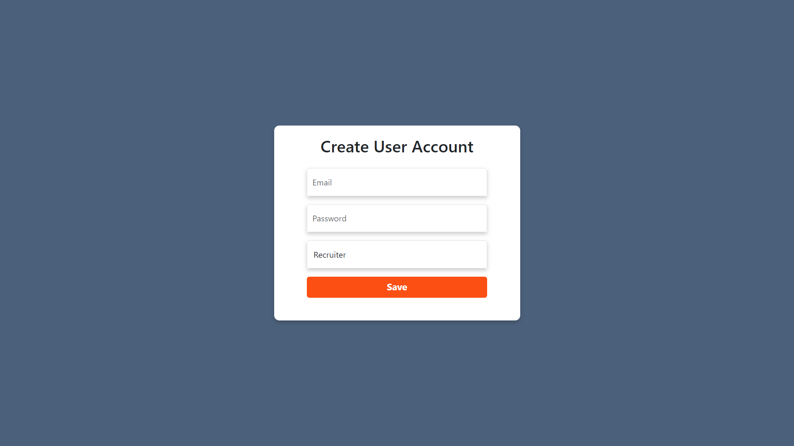
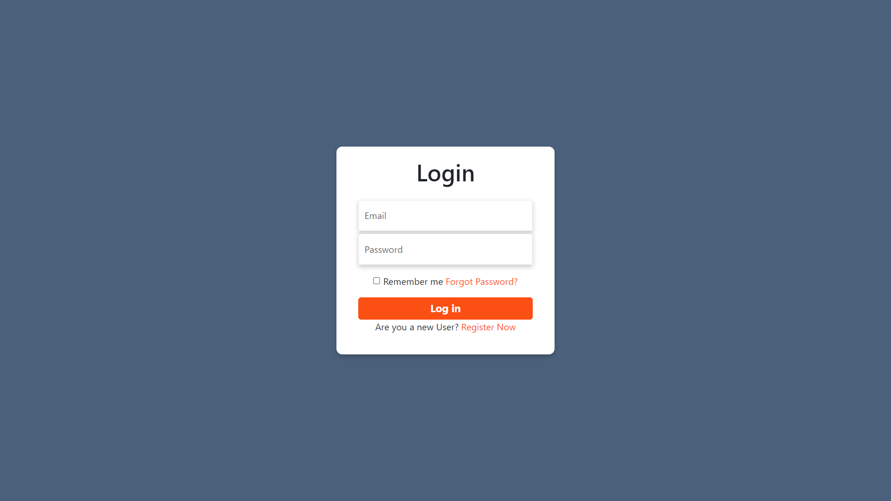
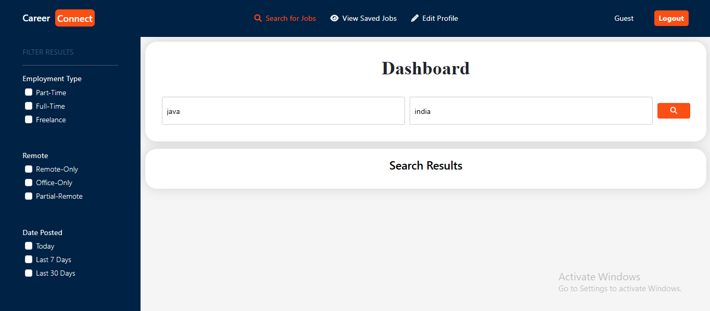
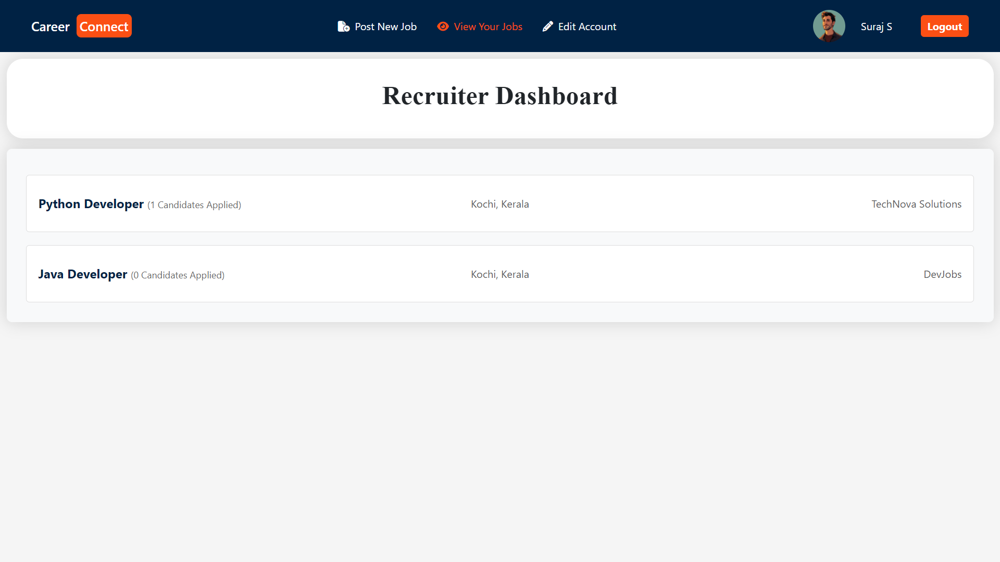
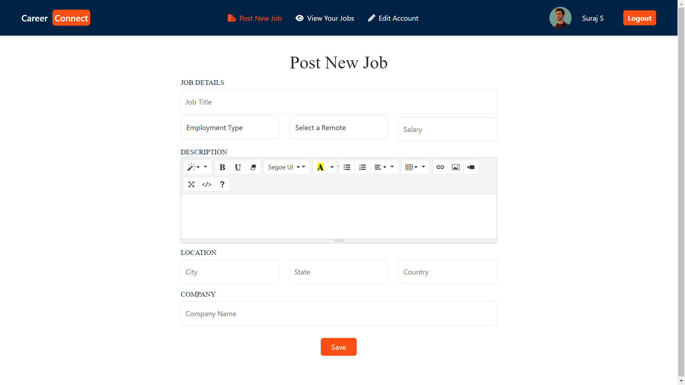
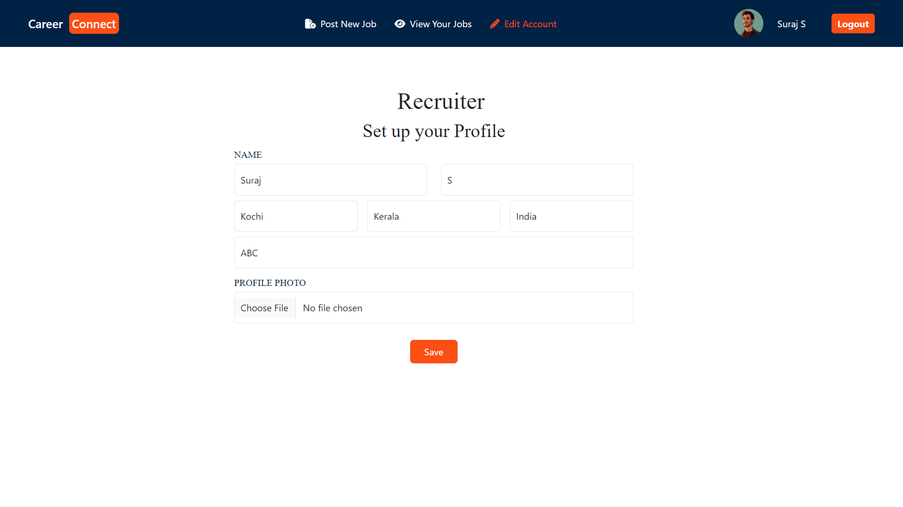
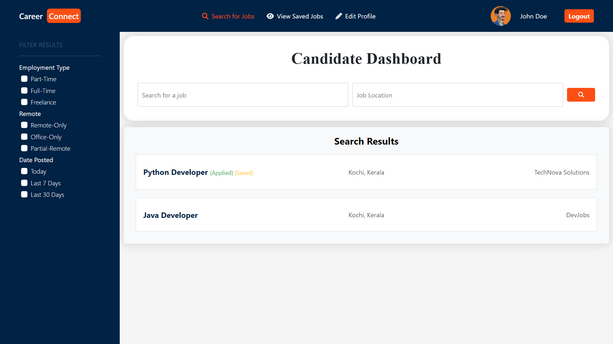
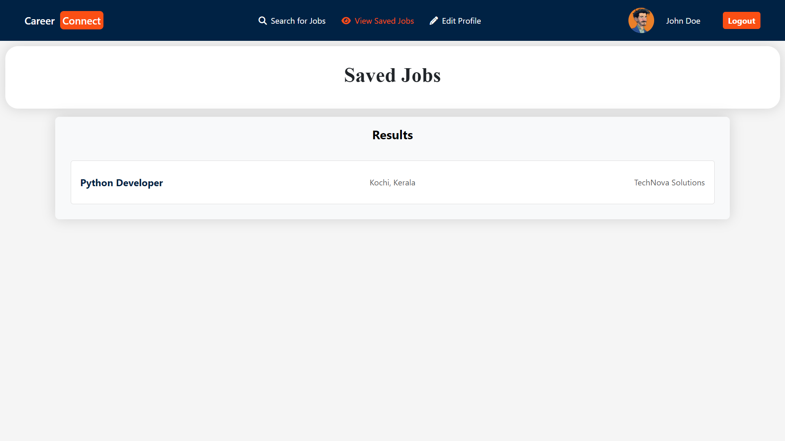
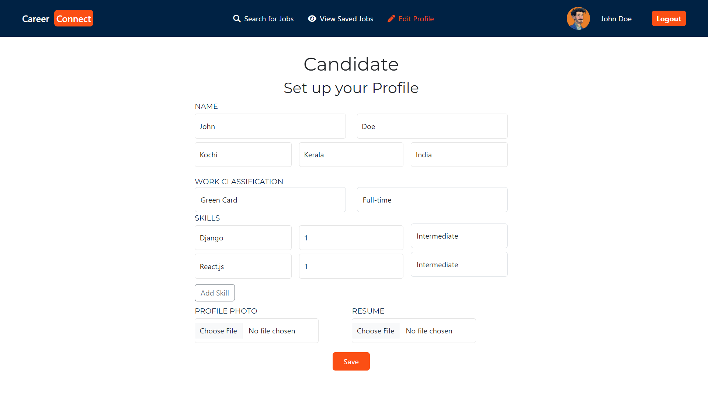

# Career Connect – Job Portal Web Application

Career Connect is a web-based recruitment management system developed using **Java and the Spring Framework**. It provides a centralized platform connecting job seekers and recruiters, simplifying the recruitment process through job postings, applications, profile management, and resume handling.

## Overview

The application provides dedicated interfaces for candidates and recruiters, allowing candidates to explore job opportunities and apply for suitable positions, while recruiters can publish vacancies and manage applications efficiently.

Built using Spring Boot and the MVC architecture, Career Connect emphasizes secure authentication, efficient database management, and a user-friendly interface.

## Features

### Candidate Module
- User registration and secure login.
- Create and update candidate profiles.
- Browse and search job opportunities.
- Apply for available job openings.
- Upload resumes and profile photos.
- Save jobs for future reference.
- View saved jobs.

### Recruiter Module
- Recruiter registration and secure login.
- Create and manage job postings.
- View posted job vacancies.
- Review candidate applications.
- Download candidate resumes.
- Manage recruiter profiles.

### Security and Management
- Role-based authentication and authorization using Spring Security.
- Password encryption.
- Custom authentication success handlers.
- CRUD operations for jobs, applications, and user profiles.
- Input validation and secure file handling.

## Technology Stack

| Technology | Purpose |
|---|---|
| Java | Backend programming |
| Spring Boot 3 | Application framework |
| Spring MVC | MVC architecture |
| Spring Security | Authentication and authorization |
| Spring Data JPA | Database operations |
| Hibernate | Object-relational mapping |
| MySQL | Relational database |
| Thymeleaf | Server-side UI rendering |
| HTML5 & CSS3 | Frontend development |
| Bootstrap | Responsive UI design |
| Maven | Dependency and build management |
| Apache Tomcat | Application server |

## Architecture

The application follows the Model–View–Controller (MVC) architecture.

- **Model:** Manages application entities and database operations.
- **View:** Renders dynamic web pages using Thymeleaf.
- **Controller:** Handles HTTP requests and coordinates application workflows.
- **Service Layer:** Implements business logic.
- **Repository Layer:** Manages database interactions using Spring Data JPA and Hibernate.

## Getting Started

### Prerequisites

Ensure the following are installed:

- Java JDK 17 or compatible version.
- Maven.
- MySQL Server.
- Git.

### Installation

**1. Clone the repository**

```bash
git clone https://github.com/Sharanya-Aithal-KS/Career-Connect.git
```

**2. Navigate to the project directory**

```bash
cd Career-Connect
```

**3. Configure the database**

Create a MySQL database and update the database credentials in:

```text
src/main/resources/application.properties
```

Configure the database URL, username, and password according to your local MySQL setup.

**4. Build the application**

On Windows:

```bash
mvnw.cmd clean install
```

Alternatively:

```bash
mvn clean install
```

**5. Run the application**

```bash
mvnw.cmd spring-boot:run
```

**6. Access the application**

Open your browser and navigate to:

```text
http://localhost:8080
```

## Project Structure

```text
Career-Connect/
│
├── .mvn/
├── src/
│   ├── main/
│   │   ├── java/
│   │   │   └── com/example/jobportal/
│   │   │       ├── config/
│   │   │       ├── controller/
│   │   │       ├── entity/
│   │   │       ├── repository/
│   │   │       ├── service/
│   │   │       └── util/
│   │   │
│   │   └── resources/
│   │       ├── static/
│   │       ├── templates/
│   │       └── application.properties
│   │
│   └── test/
│
├── Output/
├── target/
├── pom.xml
├── mvnw
├── mvnw.cmd
└── README.md
```

## User Interface

The application includes dedicated interfaces for different user roles:

- Home page with job search functionality.
- Candidate registration and login.
- Recruiter registration and login.
- Candidate dashboard and saved jobs.
- Recruiter dashboard and job posting interface.
- Candidate and recruiter profile management.


## Screenshots

The following screenshots showcase the user interface and functionalities of the Career Connect Job Portal.

### Application Screenshots






















## Future Enhancements

- AI-based job recommendations.
- Resume scoring and analysis.
- Real-time notifications.
- Recruiter–candidate chat functionality.
- Cloud deployment using AWS or Azure.
- Integration with professional networking platforms.

## Author

**Sharanya Aithal KS**

GitHub: [@Sharanya-Aithal-KS](https://github.com/Sharanya-Aithal-KS)
